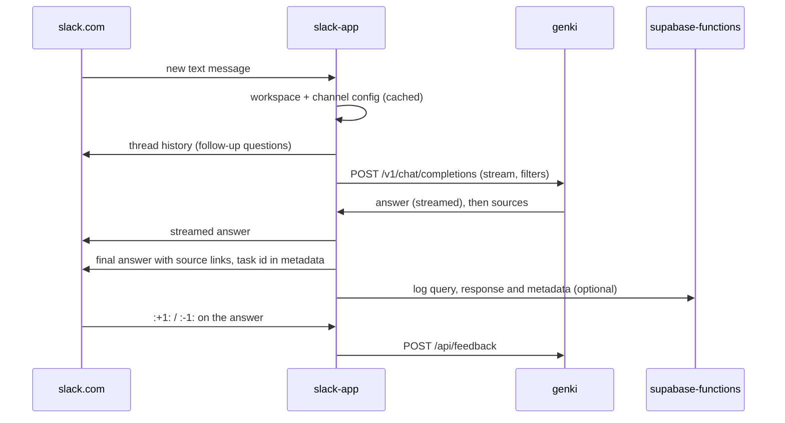

# digdir-assistants

A mono-repo for generative AI assistants, based on RAG architecture. 

Currently deployed as a Slack application, we also plan to integrate with web applications, in particular Altinn Studio.

# Agent flow 

This diagram shows the main functional blocks and how data flows between them:

## See it in action

[#altinn-assistant](https://altinndevops.slack.com/archives/C06JQLHSZME/p1707478070231209)  on Altinn Devops Slack

## Local development quickstart

1. Install dependencies:  

`$ yarn install`

2. Build all packages and apps

`$ yarn build`

3. Run slack-app and admin ui

`$ yarn run:slack-app`

Note: in order for your local bot endpoint to receive traffic from Slack, you need to configure a proxy service such as `ngrok`, and configure a Slack app to use the URL allocated by ngrok.

4. Configure a new Slack app in your test workspace

> It is recommended to create a few Slack workspace specifically for development and testing of Slack apps

## Slack app configuration

The Slack app answers with genki, through its OpenAI-compatible `/v1` API. genki searches the documentation, writes the answer in the question's language and returns the sources it cites.

Environment:

| Variable | Meaning |
| --- | --- |
| `SLACK_BOT_TOKEN`, `SLACK_BOT_SIGNING_SECRET` | The Slack app's credentials. Events arrive at `/bolt/slack/events`. |
| `SLACK_SOCKET_MODE`, `SLACK_APP_TOKEN` | Set `SLACK_SOCKET_MODE=true` and an app-level token to connect over socket mode instead, with no public URL. |
| `GENKI_API_URL` | genki's base URL, e.g. `http://localhost:8380`. |
| `GENKI_API_KEY` | An API key bound to the genki service. |
| `GENKI_MODEL` | The default model id (`<service>__<variant>`) when the config does not name one. |
| `BOT_CONFIG_FILE` | A YAML file with the workspace and channel config, see [bot-config.example.yaml](apps/slack-app/bot-config.example.yaml). Without it, the config is read from the Supabase `bot_config` table. |
| `SLACK_APP_SUPABASE_API_URL`, `SLACK_APP_SUPABASE_ANON_KEY` | Optional. Logs questions, answers and reactions for the admin app. Without them, log entries go to the console. |

Config keys, set per workspace (`team_id`) or channel (`channel_id`):

| Key | Default | Meaning |
| --- | --- | --- |
| `genki.model` | `GENKI_MODEL` | The genki model id to ask. |
| `genki.filters` | none | Filters sent with each question, e.g. `{ product: [Maskinporten] }`, or the contract's `{ fields: [...] }` shape. |
| `genki.fallback` | none | `{ model?, filters? }` to ask instead when `genki.model` does not exist (yet), for example a product variant that is not published. `model` defaults to `GENKI_MODEL`. |
| `ignoreWhenNotTagged` | `true` | In channels, answer only when the bot is mentioned. Direct messages are always answered. |
| `genki.threadRepliesNeedMention` | `false` | When `false`, a reply in a thread the bot has answered is a follow-up question and is answered with the thread as history. |
| `genki.feedbackFromAnyone` | `false` | When `false`, only the person who asked can rate an answer with :+1: / :-1:. |
| `genki.streamUpdateSec` | `1.5` | How often the streamed answer is updated in Slack. |

Each answer carries Slack message metadata with the genki task id, so :+1: / :-1: is sent to genki's feedback API, and :stopwatch: shows the sources and timing.

Run the unit tests with `cd apps/slack-app && yarn test`.

## Deploy to Azure Container app

1. Create a resouce group
2. Create a Container App Environment
3. Create a container repository
4. Create a Container App
> For step by step instructions see: [Create a Container App](/documentation/create-a-container-app.md)
   

## Manual job execution

1. Update crawler index

2. Update search phrase index

`$ cd  cli`
`$ yarn run:generateSearchPhrases <typesense collection name>`

Example collection name: TEST_altinn-studio-docs-search-phrases`

# System architecture

The Altinn Assistants architecture consists of the following technology components:

1. Front-end (Slack app, Admin web app)
2. Database-as-a-service (Supabase)
3. Serverless function runtime (Supabase Functions)
4. GPU-accelerated (Python app running in a GPU-enabled VM)
5. Text search index (Typesense Cloud)

Sequence diagram showing execution of a typical end user query:

